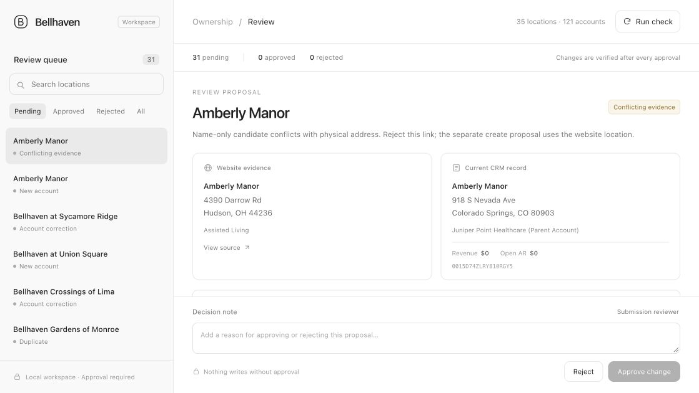

# Bellhaven ownership review

A local review queue for keeping facility ownership in sync with Bellhaven's website. Scraping and matching never write to the CRM. A reviewer must approve each proposed change, and the app reads the account back after applying it.



[Watch the two-minute demo](https://drive.google.com/file/d/1n5yyht86ruDTixaeI7G_fV4DRUSih6Ig/view) · Anyone with the link can view.

## Run locally

Requires Python 3.11+ on macOS or Linux. No third-party packages or paid services are needed.

```sh
export BELLHAVEN_API_TOKEN='your-sandbox-token'
python3 bellhaven.py run
python3 bellhaven.py serve
```

Open **http://127.0.0.1:8765**. Compare the website evidence, CRM record and proposed values. Enter a decision note, then approve or reject. The API token stays on the server; it is never sent to the browser or committed to this repository.

```sh
python3 -m unittest -v
python3 bellhaven.py export > review-export.json
```

`BELLHAVEN_STATE_DIR` sets the durable data directory (default: `state/`). Keep this directory between runs and back it up. It contains the SQLite decisions, operation journal and latest scrape. Run the scheduler and review app against the same state directory. The app binds to loopback only and protects mutations with a session token.

## Matching and decisions

- Crawl every directory page, every linked detail page and the homepage's featured-community links. Check the advertised directory count before generating proposals. The website has 34 directory entries plus Findlay on the homepage: **35 communities**.
- Fetch every CRM page, including accounts outside the Bellhaven parent.
- Normalize street abbreviations and compass directions. Prefer exact physical addresses with city/state agreement. An exact name plus city/state/ZIP may support an address correction; a name alone never identifies a facility. Scores are rule strengths, not statistical probabilities.
- Rank address-backed candidates by exact name, existing Bellhaven parent, revenue history and a deterministic account-ID tie break. Every candidate is visible to the reviewer.
- Propose new accounts, field corrections, ownership changes, duplicates and investigations separately. Existing equivalent address spellings remain unchanged by default.
- Duplicate copies get `duplicate_of_account`, `Inactive` and an explanatory note. No merge or delete is used. A possible duplicate with revenue history and open AR is held for investigation rather than inactivated.
- Missing website listings get `Needs Review` with an explanation. A missing listing does not establish a new owner; keep the parent, revenue and AR unchanged.
- Website care offerings map to CRM values: rehabilitation/nursing → `Skilled Nursing`, memory support → `Memory Care`; multiple offerings use a semicolon-separated string.

An explicit, optional formatting suggestion can be sent to the same queue:

```sh
python3 bellhaven.py suggest-address --account-id ACCOUNT_ID
```

This only proposes the website's spelling of an already equivalent address. It does not write or run as part of the daily check.

## Billing SOP and retries

Immediately before approving a parent change, refresh the account and check billing data. If both lifetime revenue and outstanding AR are positive, create a new facility account under Bellhaven and update **only** the old account's `chow_current_account` pointer. Preserve the old parent and all other old fields. Otherwise re-parent the existing account directly. Missing or invalid financial values fail closed.

Stable proposal IDs preserve both approvals and rejections. A local file lock serializes runs and decisions. Fresh account comparisons prevent applying stale proposals. The create journal is committed before a POST; a unique note marker allows finding an already-created account after an interruption. A missing result after an uncertain POST blocks another create until investigated. Interrupted CHOW operations remain reviewable after daily reruns. Mutations are never blindly retried.

The API has no atomic compare-and-set or documented idempotency key. There remains a narrow external-writer race between the preflight GET and PATCH; local locking cannot protect other clients. This is a single-machine review tool. Shared production use should add authentication, centrally durable state and server-side concurrency control.

## Daily schedule

`schedule.cron` is the proposed daily 06:15 America/New_York configuration; it is **not installed or live**. Replace the absolute paths and put the exported token and absolute `BELLHAVEN_STATE_DIR` in an owner-readable environment file outside the repository. The scheduled job only generates a queue. Approval remains manual.

## Verified submission results

The sandbox was actually corrected through this app:

| Result | Count |
|---|---:|
| Website communities with exactly one current active Bellhaven account | 35 |
| Initial → final CRM accounts | 121 → 127 |
| Approved decisions | 31 |
| Rejected decisions | 2 |
| CHOW accounts created with old billing records preserved | 2 |
| Inactive duplicate copies linked to survivors | 7 |
| Unlisted accounts marked Needs Review | 3 |
| New proposals on the final daily rerun | 0 |
| Pending proposals after that rerun | 0 |

The original 30 corrective proposals were approved and the Colorado/OH name-only association was rejected. The demonstration also approved one equivalent Maplewood address spelling (`Ln` → `Lane`) and rejected an optional Wooster spelling change. The latter formatting proposals are explicit reviewer requests, not daily ownership findings.

Tiffin ($84,000 revenue / $12,400 AR) and Marietta ($51,250 / $3,800) use CHOW. All original fields were compared with the initial snapshot and preserved, except the intended pointer and server-managed update timestamp. Alliance, Coldwater and Sandusky remain under their existing parent with `Needs Review`; the website alone does not establish their current ownership. The Colorado Springs Amberly Manor and the unrelated Union Square account at a different address were left alone.

`submission/locations.json`, `submission/review-decisions.json` and `submission/results.json` contain the evidence and final verification. `WRITEUP.md` explains the approach and next steps. The demo uses actual browser captures with synthesized narration; no personal voice was recorded.
